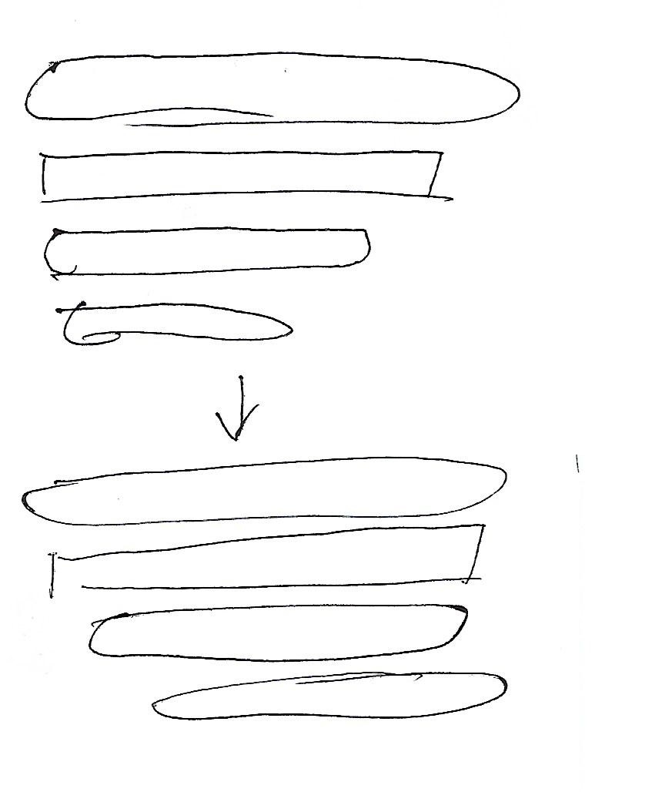
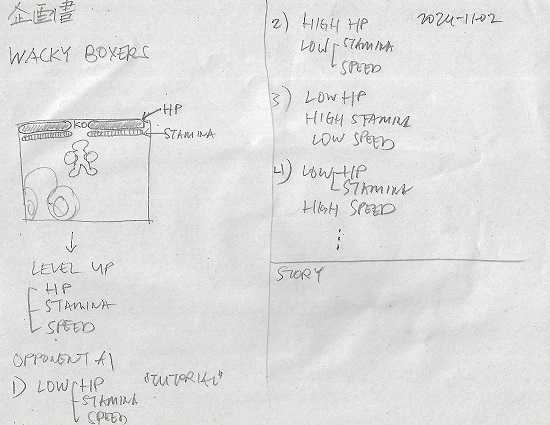

# GitHub x ITCH.IO 

This is the GitHub repository of our entry for Game Off 2026 with the theme SHIFT.

### ITCH.IO: PROTOTYPES

#### 1) 20261102; https://masarapmabuhay.itch.io/game-off-2026-prototype1

#### 2) 20261103-20261105; https://masarapmabuhay.itch.io/game-off-2026-prototype2

20261103: P1 auto-faces opponent   

20261104: 
1) Opponent auto-faces P1 at very close-range; faces downward if too close; 
2) HP gauges for both fighters; HP deductions for P1 move from left to right, while for Opponent, it's from right to left; 

20261105: 
1) Boundaries to prevent the P1 from wandering away;
2) Functional level up upon defeating the Opponent;

#### 3) 20261105-20261110; https://masarapmabuhay.itch.io/game-off-2026-prototype3

20261105: key input "J" to attack instead of P1 auto-attacking when near the Opponent

20261106-20261107: Fixed clunky controls related to how long P1 held "J", etc; simple control mechanism with choices; Coins come out upon hitting the Opponent.

20261108: Coins jump out from the Opponent and are affected by gravity. P1 or Opponent gives out the sound of squeezed bicycle horn when hit.

20261109: Mouse left-click now also does exactly what pressing "J" on the keyboard does. P2 could also make use of the "Enter" key on the numberpad to do the same thing for his character. I've added "Skel" (a "Drudge Skeleton") as one of the characters in the roster. Updating the faces, which were ruined after scaling to `96x96px` from `64x64px`, took as long as `1.5 hrs`. Meanwhile, the coin's image sprite is still undergoing testing. The marking inside is supposed to be an hourglass, only it currently looks like Spider-man's face.

20261110: Sound now comes out whenever P1 collects a coin. I've also disabled the default behavior of the arrow keys and the numpad keys, because I noticed that on itch.io, these keys also scroll the page or move out of full screen mode. I then updated the image sprites for our new character, "Einstein;" however, getting only the animation sprites for movement without the attacks or when getting hit already took me an afternoon totaling to `2hrs`.

#### 4) 20261111-20261115; https://masarapmabuhay.itch.io/game-off-2026-prototype4

20261111: The first BGM recording now plays once P1 hits the Opponent. The next two BGM recordings play upon hitting the Opponent two more times. When P1's life bar is reduced to `<=` half his total life points upon getting hit, then only the first BGM recording is played. The rest are again played following the rules stated previously. I've also added the title screen, how-to screen and the story screen, things that are commonly used in any game. Finally, I've updated Einstein's image sprite sheet, though even after another `1.5hrs`, I haven't yet finished all the necessary animation frames.

20261112: I've added a fourth BGM, made the life bars larger with animation for both P1 and Opponent. No sprite image updates today, unfortunately. Staff member at the clinic intentionally used an eye-irritating substance that lingered in the air. Beware of fake online products knowingly used by people with financial problems.  

20261113: Today's major update is the new boxing ring graphics. I've also updated the coin object's logic, so that it doesn't gravitate toward the hero's position. Also, more coins come out upon defeating the opponent. I've also found and fixed bugs in the code, especially those related to the next opponent `transition`, wherein because I set all the actors' `visibility` to `hidden`, when a part of the code immediately tries to access an actor that's still set to `hidden`, the hero can't move or attack at all. This error doesn't anymore appear at least based on my tests so far.

20261114: I've updated more animation sprite images for Einstein, though there are still a few that remain. I'm thinking of not using these remaining ones anymore, because it would again take at most another afternoon to finish the task. Updating the code appears to me to be a lot faster. Also, both P1 and the Opponent have the stamina bar and the coins count; however, the Opponent immediately gets the coin whenever he's punched, so this part should be updated. I've set aside most of the programming work for tomorrow and spent more of my time today on updating the sprite images, because it's easier for me to do the latter in my current setup at the clinic.

20261115: I did try out updating the sprite images last night, but eventually decided to simply do away with the animation frames when the character is moving or attacking directly upward or downward, because it's taking me over `2hrs` just to get the character's face right. At a certain angle, Einstein, a female hybrid of a Japanese Spitz and the so-called Askal (Wild Street Dog), looked like a smiling character from Dragon Ball Z. At one point, I thought that he looked like Majin Buu (The fat alien lifeform who becomes the friend of Mr. Satan ("Mr. Pogi" in the Filipino dubbing). Having said this, updating the code was really much faster, taking me only less than an hour to finish. Also, today I put the font style that I had prepared beforehand to good use, though I still had to update the spacing at the code level. There are still some gameplay-related bugs left that I haven't been able to fix. This part is the tedious one to do programming-wise. I plan to get a working game done by tomorrow.

#### 5) 20261116; https://masarapmabuhay.itch.io/game-off-2026-milestone1

20261116: Here's the output after two weeks of development: A simple game with the goal of getting the most money.

https://github.com/usbong/game-off-2026/releases/tag/output

#### 6) 20261117-20261125; https://masarapmabuhay.itch.io/game-off-2026-prototypem1-1

20261117: First prototype of the two player versus mode. Unfair damage, wrong movement related to viewport, etc.

20261118: Second prototype. Hit animation for 1P only uses one frame. Continuing or starting a new game when 1P has lost requires another "J" key press or left-click.

20261119: Prototype#3. Fixed transition bug that required another key press to start after 1P beats 2P. Took longer than I would have wanted. Animation, z-index-related bugs next to be fixed.

20261120: Prototype#4. Put together working version of Single Player and Versus Mode. Fixed wrong movement related to viewport bug, among other known issues. SHIFT + ENTER while in the start page to play the versus mode.

20261121: Prototype#5. Fixed animations including the timers, so that the hero doesn't immediately return to idle animation upon getting hit. The stamina bar for 1P is now consumed from left to right, while for 2P it's from right to left.

20261122: Prototype#6. Card Slots.

20261123: Prototype#7. Combo Counts.

20261124: Prototype#8. Stage Transitions. PRACTICE Mode before NEXT CHALLENGER. More challenging AI opponent.

20261125: Prototype#9. Start to End. With New Game+ via 2P mode. More background graphics and animations to come. 

## Related link

1) https://philnits.org/

## Open Source Software License

Copyright 2026 USBONG

Licensed under the Apache License, Version 2.0 (the "License"); you may not use this file except in compliance with the License. You may obtain a copy of the License at

   http://www.apache.org/licenses/LICENSE-2.0
  
Unless required by applicable law or agreed to in writing, software distributed under the License is distributed on an "AS IS" BASIS, WITHOUT WARRANTIES OR CONDITIONS OF ANY KIND, either express or implied. See the License for the specific language governing permissions and limitations under the License.

@company: USBONG 
@author: SYSON, MICHAEL B., et al. 
@website address: http://www.usbong.ph 
